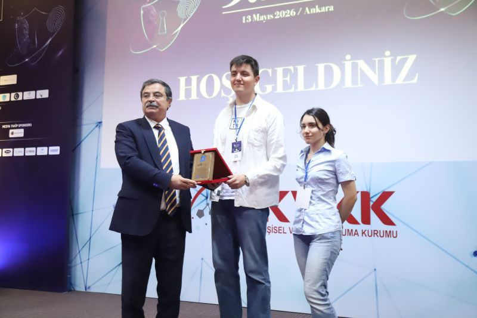
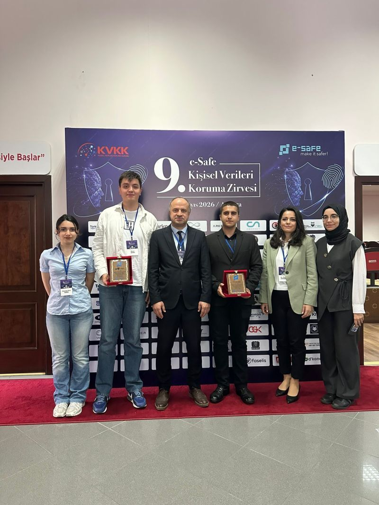
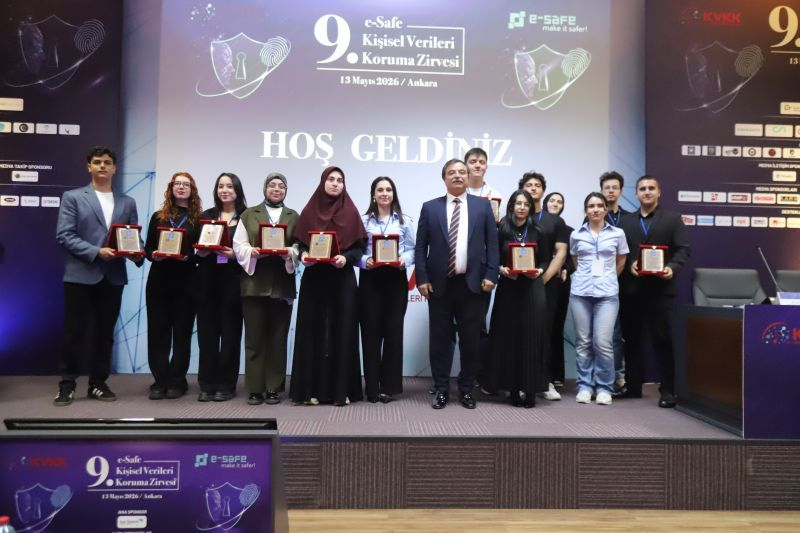

13 Mayıs 2026'da Ankara'da, Kişisel Verileri Koruma Kurumu (KVKK) ev sahipliğinde düzenlenen **9. e-Safe Kişisel Verileri Koruma Zirvesi**'nde Ankara University Cyber Club (AUCC) olarak yerimizi aldık.

Sektörel farkındalığı artırma yolundaki çalışmalarımız ve siber güvenlik ekosistemine sunduğumuz katkılar dolayısıyla topluluğumuz **plaketle onurlandırıldı**. Geleceğin uzmanları olarak, verinin güvenliği ve gizliliği üzerine inşa edilecek projelerde daha güçlü adımlarla yürümeye devam edeceğiz.

**Zirve temsilcilerimiz:**

- 🛡️ **Ömer Opan** — Yönetim Kurulu Başkanı
- 🛡️ **Zeynep Sıla Orsa** — Yönetim Kurulu Başkan Yardımcısı

Değerli plaket takdimleri için KVKK Başkan Yardımcısı Sayın Dr. Cihan Kanlıgöz'e; bu kıymetli organizasyon ve davetleri için e-Safe Kurucusu Musa Savaş ve e-Safe Başkanı Özge Evci Eralp'e teşekkürlerimizi sunarız.

Bu anlamlı organizasyon için e-Safe ekibine ve tüm paydaşlarımıza teşekkür ederiz. 🤝
